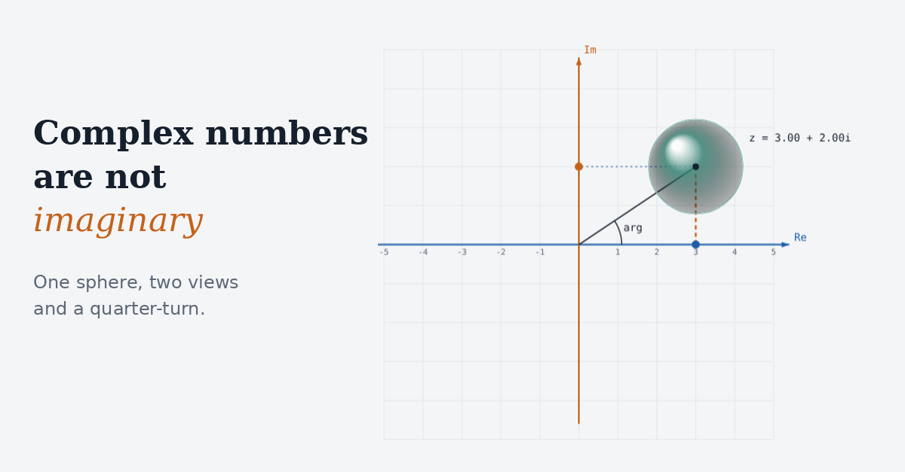

# Complex Numbers Are Not Imaginary

An interactive visualization for understanding complex numbers with one sphere, two views and a quarter-turn.

👉 **Open it here: https://ninjas1337.github.io/Imaginary-numbers-are-real/**

## Motivation

I made this project because I did not truly understand complex numbers when they were first presented to me as symbols alone during engineering studies.

What finally made them click for me was geometry: a circle, a rotating wheel, a wobbling motion, a keyphasor. When I started thinking of a complex number as something real that can rotate, tilt, and project, it stopped feeling abstract and started feeling obvious. Sadly we do seldom learn it that way. 

This project is my attempt to share that intuition.

My hope is simple: that more people will truly understand complex numbers, not just calculate with them. They are beautiful. They are not "imaginary" in the everyday sense. They are a powerful and elegant way of describing rotation, phase, orthogonality, and hidden structure.

## What this project shows

A sphere sits in space with its centre at a complex number z = Re + i·Im.

- **From the front** you look straight at the complex plane: you see a circle, its centre, the real part and the imaginary part.
- **From above** you still see a circle (a sphere is round from every side), but now the imaginary part points straight at your eye. Only the real part is visible. The "imaginary" part is simply the part of the position at right angles to the number line.
- **Distance and angle:** the modulus |z| says how far the centre is from 0, the argument says in which direction.
- **Multiply by i** turns the sphere a quarter-turn around 0. Twice is a half-turn, which is why i·i = −1.

The goal is not to replace formal mathematics, but to provide intuition to formal mathematics.

## Why it matters

Complex numbers appear everywhere in mathematics, physics, and engineering:

- AC systems and phasors
- waves and oscillations
- signal processing
- control theory
- rotations and phase relationships

Yet many people meet them in a way that makes them seem artificial or mysterious. I believe they deserve better. They are one of the most beautiful ideas in mathematics.

## Related

The same idea, one sphere per prime, each touching the next, leads to a picture of the Riemann Hypothesis: [The Riemann Hypothesis, drawn with circles](https://ninjas1337.github.io/Riemann-Hypothesis-Drawn-with-Circles/).

The previous version of this page (a tilting circle of radius π) is kept in the git history.

## Note

This project is for educational and informational purposes. It is a geometric intuition tool. It does not claim that the imaginary axis is literally a hidden physical dimension. It is a way of helping the mind see what the algebra is already saying.

## Idea

If this project helps even one person feel that complex numbers are no longer strange, but elegant and understandable, then it has done its job.
